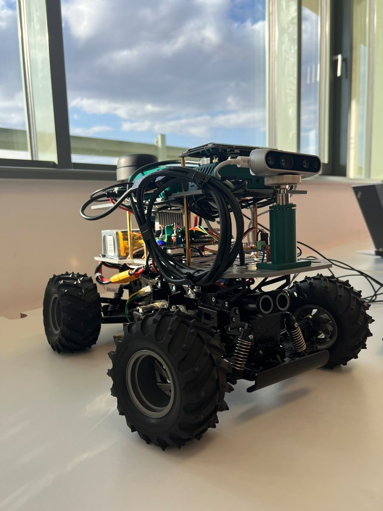
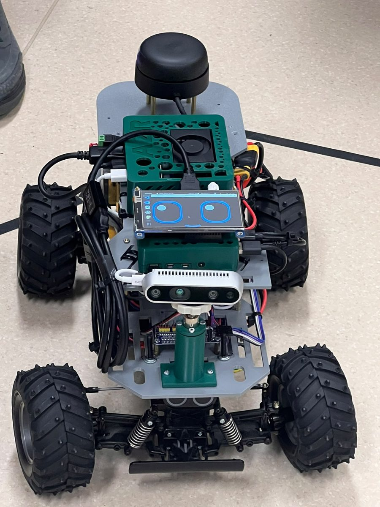

# A2R-bot

A small RC car that follows its owner around.

I built this on top of a 1:10 Ackermann RC chassis. You raise your hand in front of it, it learns what you look like, and from then on it follows you at a couple of metres, indoors or outside, while trying not to hit anything (or anyone) on the way. It ignores other people, and if it loses you for a moment it keeps track of where you probably are using the lidar until the camera finds you again.

<p align="center">
  
  
</p>

The person-recognition part started from [FollowMe](https://arxiv.org/abs/2311.12992) (Rollo et al.), which I adapted to run on a Jetson and extended in two ways:

- **multi-view re-identification**: instead of one "average" picture of the owner, the robot keeps many separate views (front, back, side, near, far) and compares new detections against the closest ones;
- **lidar owner keeping**: a 2D lidar tracker that holds on to the owner when the camera loses them, which happens a lot on a car that can't turn on the spot.

This was my student research project (TDK) at the University of Debrecen, Faculty of Engineering, in 2026.

## What's in the repo

```
robot_ws/              ROS 2 workspace that runs on the Raspberry Pi 4
  src/a2r_bot_follow/      owner fusion, Kalman filter, follow manager, local planner,
                           collision monitor, command mux
  src/a2r_bot_arduino/     serial bridge + ESP32 firmware (servo, ESC, IMU, battery)
  src/a2r_bot_description/ URDF model
  src/a2r_bot_info/docs/   older notes: architecture, topics, kinematics, wiring, testing
jetson_owner_tracker/  perception on the Jetson (FollowMe adaptation, re-ID, gestures,
                       lidar owner keeper, ROS 2 nodes in ros2/followme_ros)
robot_face/            the little face shown on the robot's display
hardware/              KiCad project of the carrier board + schematic / PCB renders
tools/simulation/      MATLAB / Python simulation of the follow controller
legacy_ros2_ws/        my first prototype (simple human tracker), kept for reference
```

## How it works (short version)

```
 RealSense D435 ──► Jetson: segment people ─► re-ID ─► "is this my owner?" ─► owner position
                                                                │
 RPLIDAR A2M12 ───► Jetson: lidar owner keeper ◄────────────────┘ (camera picks the track)
                                │
                                ▼
                    Raspberry Pi 4: owner fusion ─► Kalman filter ─► goal 1.6 m behind owner
                                                     ─► local planner ─► collision monitor
                                │
                                ▼  JSON over serial
                    Arduino Nano ESP32 ─► PCA9685 ─► steering servo + ESC
```

The Jetson does everything that needs a GPU: person segmentation (YOLO11n-seg), appearance embeddings (OSNet), deciding which person is the owner, and hand gestures. It also runs the lidar keeper, because the keeper and the camera have to talk to each other constantly. The Raspberry Pi does the "driving" part: it fuses the owner position, filters it, picks a goal point and plans a path that the Ackermann steering can actually follow. The ESP32 only turns speed and steering commands into PWM and has a watchdog that stops the car if commands stop arriving.

The longer explanation, including how enrolment, the re-ID decision and the lidar keeper work, is in [docs/how-it-works.md](docs/how-it-works.md). Parts and wiring are in [docs/hardware.md](docs/hardware.md).

## Running it

You need ROS 2 (I used Humble) on both the Pi and the Jetson, on the same network.

**Raspberry Pi**

```bash
cd robot_ws
colcon build --symlink-install
source install/setup.bash
ros2 launch a2r_bot_follow follow.launch.py
```

**Jetson**

The model files are not in the repo (too big). Export YOLO11n-seg and OSNet x1_0 to TensorRT on the Jetson first; the steps are in [jetson_owner_tracker/README_FOLLOWME.md](jetson_owner_tracker/README_FOLLOWME.md). Then:

```bash
cd jetson_owner_tracker
pip install -r requirements.txt
# build the ROS 2 package in ros2/followme_ros, then:
ros2 launch followme_ros followme.launch.py
```

**ESP32 firmware**

Open `robot_ws/src/a2r_bot_arduino/firmware/a2r_bot_firmware/` in the Arduino IDE (board: Arduino Nano ESP32) and flash it. The serial protocol is described in [SERIAL_PROTOCOL.md](robot_ws/src/a2r_bot_info/docs/SERIAL_PROTOCOL.md).

**Using the robot**

1. Stand alone in front of the camera, about 2 m away, and hold up an open hand for a second or two.
2. Stay in view while it learns you (about 12 seconds). Turning around slowly helps.
3. Make a fist to start following, show a low open palm to make it wait. Hold your hand up for 3 s to release it.

The more detailed bring-up checklist is in [QUICKSTART.md](robot_ws/src/a2r_bot_info/docs/QUICKSTART.md), and [TROUBLESHOOTING.md](robot_ws/src/a2r_bot_info/docs/TROUBLESHOOTING.md) has the problems I ran into.

## Configuration

Most parameters live in `robot_ws/src/a2r_bot_follow/config/params.yaml` (follow distance, planner choice, speed limits, collision zones) and `jetson_owner_tracker/config/followme_deploy.yaml` (detection, re-ID and enrolment settings).

The GPS fallback uses a SIM7600 modem and reads the owner's phone position from a Firebase database. I removed my own database URL and SIM PIN from the code, so set `firebase_url` and `sim_pin` in `params.yaml` yourself if you want that feature, and don't commit them.

## Known issues / TODO

- When it loses you it searches by turning in place, which is not great for a car. It should drive towards the last place it saw you.
- Recognition gets unreliable when you are further than ~3.5 m away or very close (only legs in view).
- Enrolment can lock onto the wrong person if someone else is in view at the same time. Do it alone for now.
- There are no wheel encoders, so speed control is open loop.
- The carrier board mixes 3.3 V and 5 V I²C pull-ups and powers the ESP32 only from USB. That probably explains the occasional "PCA9685 not responding" and serial reconnects; it's on the list for the next board revision.
- The lidar keeper's leg-shape identity model (`leg_signature.py`) only runs in logging mode so far.

## Credits

- FollowMe: F. Rollo, A. Zunino, G. Raiola, F. Amadio, A. Ajoudani, N. Tsagarakis, *FollowMe: a robust person following framework based on visual re-identification and gestures*, arXiv:2311.12992.
- OSNet (K. Zhou et al.), YOLO11 (Ultralytics), MediaPipe Hands, ROS 2, Slamtec sllidar_ros2, Intel RealSense SDK.
