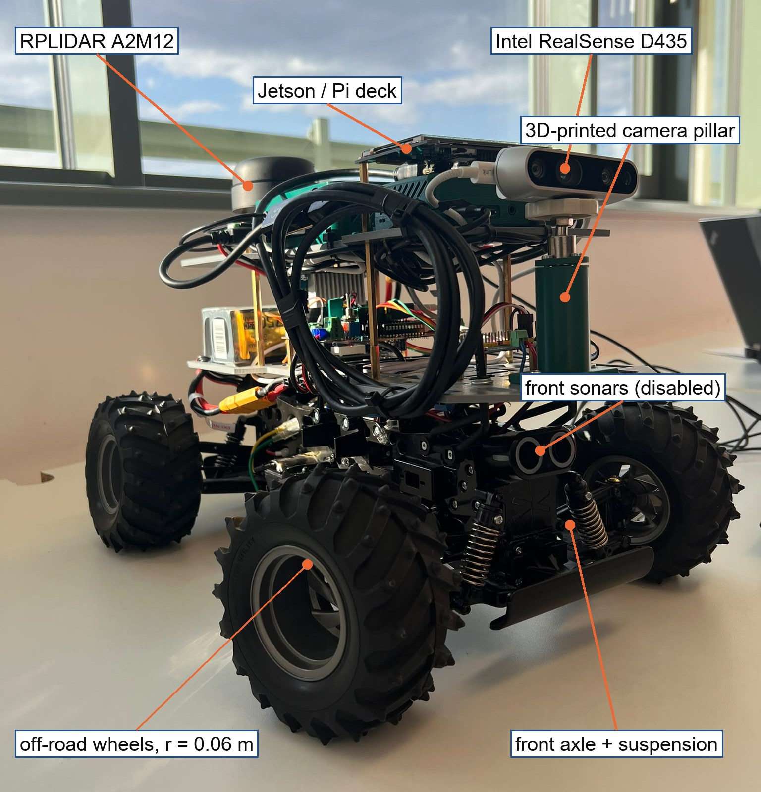
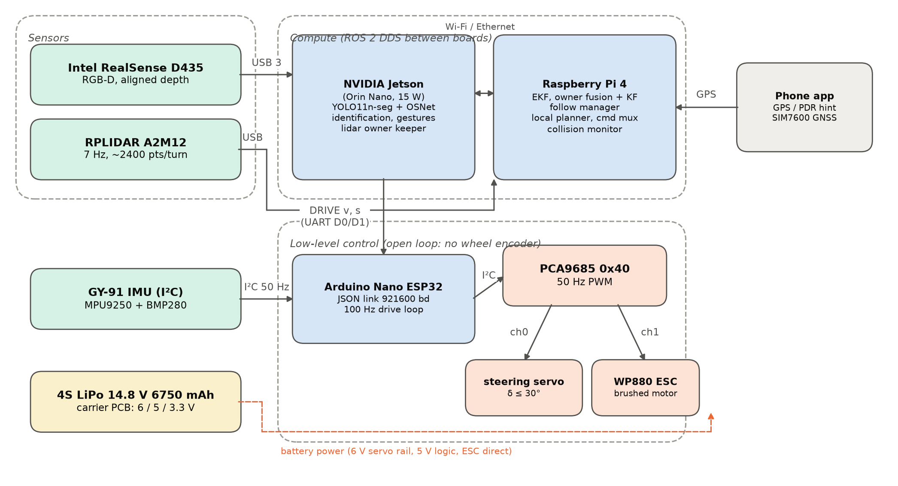

# A2R-bot — Embedded Owner Following on an Ackermann Robot

**Adapting FollowMe with multi-view re-identification and LiDAR-assisted owner keeping**

A2R-bot is a small Ackermann-steered robot car that recognises its owner, follows them indoors and outdoors, and avoids obstacles. It runs entirely on embedded hardware: an NVIDIA Jetson for perception, a Raspberry Pi 4 for fusion, planning and safety, and an Arduino Nano ESP32 on a custom carrier PCB for the actuators.

This repository contains the source code, firmware, electronics design, analysis scripts, field-test data and documentation of the project (TDK research project, University of Debrecen, Faculty of Engineering, 2026).

## Highlights

| | |
|---|---|
| Field tests (20–22 Oct 2026) | 12 of 15 follow runs completed, 446 m, no collisions |
| LiDAR owner keeper | supplied the owner position for **89.9 %** of the tracked time |
| Multi-view re-identification | 89.8 % owner acceptance on held-out frames, 0 of 295 volunteer frames accepted |
| Owner range accuracy | camera 3.3 cm MAE, lidar 11.1 cm MAE (1–5 m) |
| Perception on the Jetson | median 74 ms per frame (YOLO11n-seg + OSNet, TensorRT FP16) |

Open issues found in the evaluation: no owner fix for 51.9 % of moving time, zero identification beyond 3.5 m, search by rotating in place, and I²C / serial-link faults traced to the carrier board (see [docs/RESULTS.md](docs/RESULTS.md)).

## How it works

1. **Perception (Jetson, `jetson_owner_tracker/`)** — a FollowMe-based pipeline: YOLO11n-seg person segmentation → OSNet x1_0 embeddings → owner identification → masked-depth localisation, plus MediaPipe hand gestures for enrolment (raised palm) and FOLLOW/WAIT commands.
2. **Multi-view re-identification** — every enrolment crop is kept as its own reference view (80 gallery views + up to 400 online views); a candidate is scored by its three nearest views, checked against a stranger bank, and accepted through a five-stage cascade (strict → continuity → relaxed → far → lidar).
3. **LiDAR-assisted owner keeping (`lidar_owner_keeper.py`)** — tracks every leg/body cluster in the 2D scan, lets the camera decide which track is the owner, keeps that track through camera drop-outs, and feeds a 0.8 m hint back into identification.
4. **Fusion, planning and safety (Raspberry Pi, `robot_ws/`)** — owner fusion and a constant-velocity Kalman filter with χ² gating, a pure-pursuit goal law with DWA / VFH+ / APF local planners, a priority command multiplexer and a speed-dependent collision monitor.
5. **Low level (Arduino Nano ESP32, `robot_ws/src/a2r_bot_arduino/firmware/`)** — JSON serial protocol, PCA9685 PWM for the steering servo and ESC, IMU telemetry, watchdogs.

Details: [docs/PROJECT_OVERVIEW.md](docs/PROJECT_OVERVIEW.md).

## Repository layout

| Folder | Content |
|---|---|
| `robot_ws/` | ROS 2 workspace for the Raspberry Pi: `a2r_bot_follow` (owner fusion, follow manager, owner KF, smart planner, collision monitor, command mux), `a2r_bot_arduino` (serial bridge + ESP32 firmware), `a2r_bot_description` (URDF), `a2r_bot_info/docs` (architecture, hardware, kinematics, planners, protocol, testing guides) |
| `jetson_owner_tracker/` | Jetson perception: FollowMe adaptation, multi-view Re-ID, ownership state machine, gestures, LiDAR owner keeper, ROS 2 nodes (`ros2/followme_ros`) |
| `robot_face/` | Robot face UI shown on the LCD |
| `legacy_ros2_ws/` | Earlier prototype workspace (human tracker, pet-car behaviour) |
| `hardware/` | KiCad 9 project of the carrier PCB and schematic / 3D renders |
| `analysis/` | MATLAB simulation of the follow law, offline analysis scripts, thesis figure scripts and the figure-data workbook |
| `data/` | Field-test summaries, event logs and stack logs (20–22 Oct 2026), range-accuracy sweep |
| `docs/` | Project overview, results, electronics review and figures |

## Getting started

- Robot (Raspberry Pi 4, ROS 2): see [robot_ws/README.md](robot_ws/README.md) and [QUICKSTART](robot_ws/src/a2r_bot_info/docs/QUICKSTART.md).
- Jetson perception: see [jetson_owner_tracker/README.md](jetson_owner_tracker/README.md) and [README_FOLLOWME.md](jetson_owner_tracker/README_FOLLOWME.md). The TensorRT engines and model weights are **not** included (size and licence); build them from the original YOLO11n-seg and OSNet weights as described there.
- Wiring and firmware: [WIRING.md](robot_ws/src/a2r_bot_arduino/docs/WIRING.md), [SERIAL_PROTOCOL.md](robot_ws/src/a2r_bot_info/docs/SERIAL_PROTOCOL.md).
- Figures and analysis: open MATLAB in `analysis/thesis_figures_matlab` and run `make_all_figures` (reads `analysis/A2R-bot_TDK_Thesis_Figure_Data.xlsx`).

**Configuration secrets.** The Firebase database URL and the SIM PIN of the GNSS/LTE modem have been replaced with placeholders in `robot_ws/src/a2r_bot_follow/config/params.yaml`, `gps_owner_node.py` and `phone_pdr_node.py`. Set your own values locally and do not commit them.

## Acknowledgements

The perception pipeline builds on **FollowMe** (F. Rollo et al., "FollowMe: a robust person following framework based on visual re-identification and gestures", arXiv:2311.12992) and uses OSNet (K. Zhou et al.), YOLO11 (Ultralytics), MediaPipe Hands and ROS 2.

Authors: Manuel Afonso Fernandes Junior 
