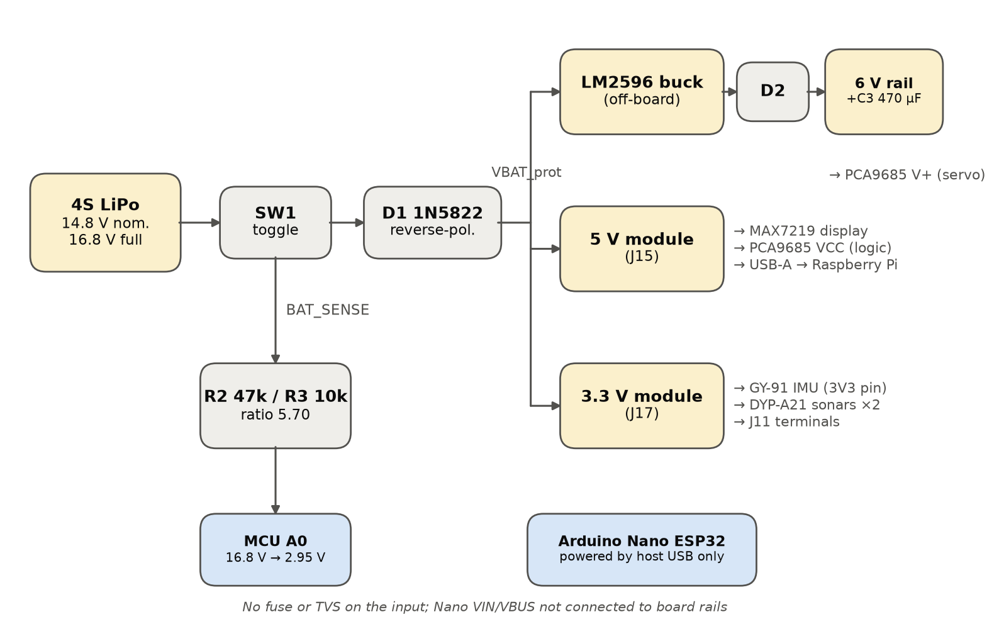
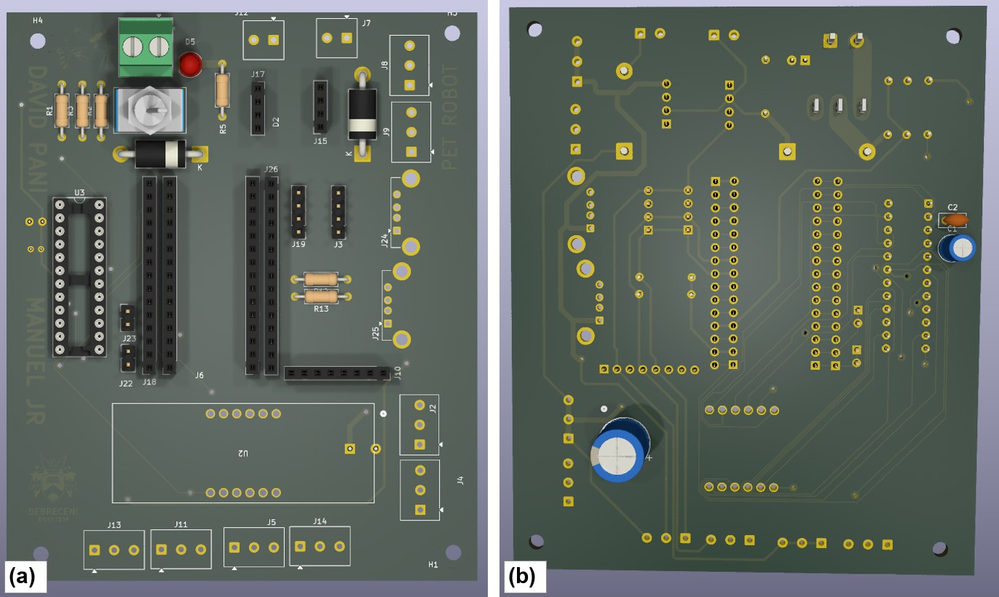
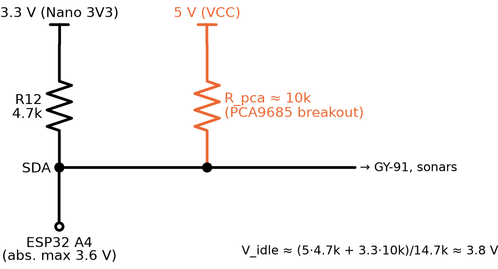

# Carrier PCB and electronics review

KiCad 9 project: [`hardware/carrier_pcb_kicad`](../hardware/carrier_pcb_kicad). Two-layer, 90.93 × 109.74 mm, 45 through-hole footprints, 438 track segments, 12 vias.

- 4S LiPo → toggle switch → 1N5822 reverse-polarity diode → off-board LM2596 (6 V servo rail, via a second 1N5822 and 470 µF), 5 V module (display, PCA9685 logic, USB-A outputs for the Pi), 3.3 V module (IMU, sonars).
- Battery sense: 47 kΩ / 10 kΩ divider to A0 (16.8 V → 2.95 V).
- The Arduino Nano ESP32 is powered only from host USB (VIN/VBUS not connected to the board rails).

## Field faults and hypotheses

The logs of 21–22 October contain 326 "Arduino silent … reopening the serial link" events and 16 "PCA9685 not responding … check SDA/SCL" events.

| # | Finding | Possible consequence | Proposed fix |
|---|---|---|---|
| H1 | I²C pull-ups to 3.3 V (R12/R13 4.7 kΩ) and to 5 V (PCA9685 breakout, ~10 kΩ) on one bus | idle ≈ 3.8 V > ESP32-S3 abs. max 3.6 V; marginal ACKs | remove the breakout pull-ups or run PCA9685 VCC at 3.3 V |
| H2 | MCU on host USB, peripherals on battery | back-powering; PCA9685 resets and loses configuration | power the Nano from the board 5 V rail via a diode |
| H3 | Two ground paths (USB and board), no stitching vias | ground bounce resets the USB-CDC link | isolated USB hub or UART only; GND stitching |
| H4 | Long untwisted I²C leads near motor wiring | bit errors, bus lock-up | twisted pairs, 33–100 Ω series resistors, bus recovery |
| H5 | 0.5 mm LM2596→D2 trace, shared 5 V module | brown-out of Pi and PCA9685 on servo stall | wider trace, separate 5 V supply for the Pi |
| H6 | No fuse, TVS or local decoupling at connectors | transients reach logic | polyfuse, TVS, 10–100 µF per connector |

These are hypotheses from the design review; confirm them with measurements (SDA/SCL idle voltage, rail ripple during throttle and steering steps).
