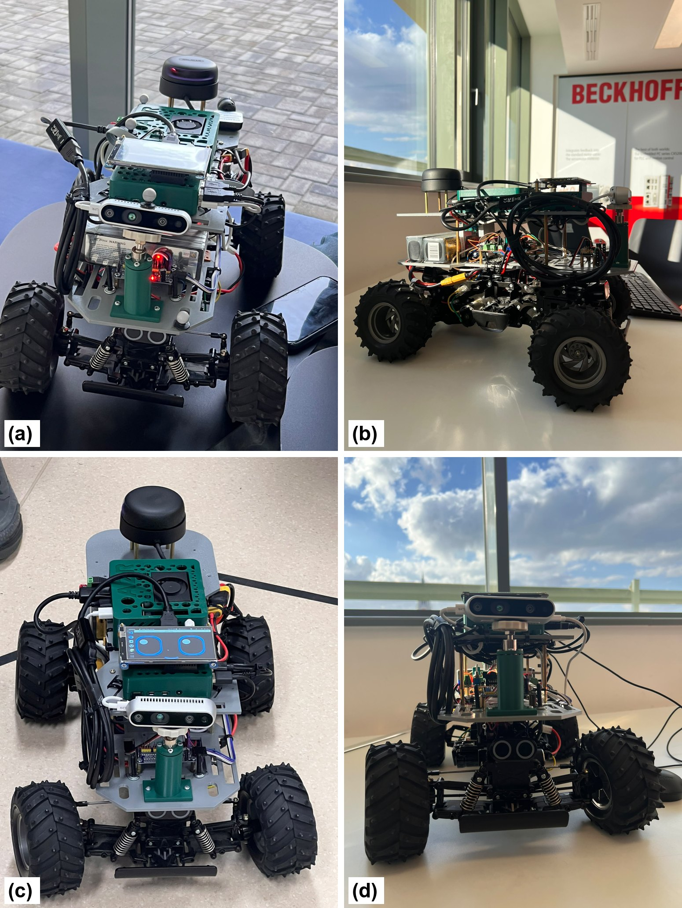
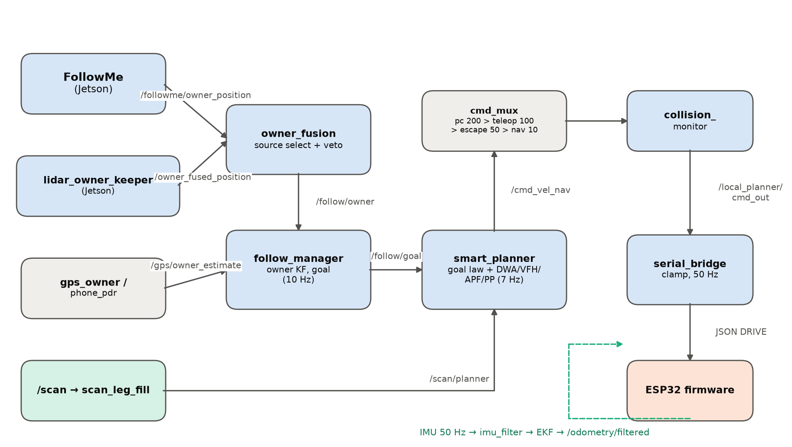
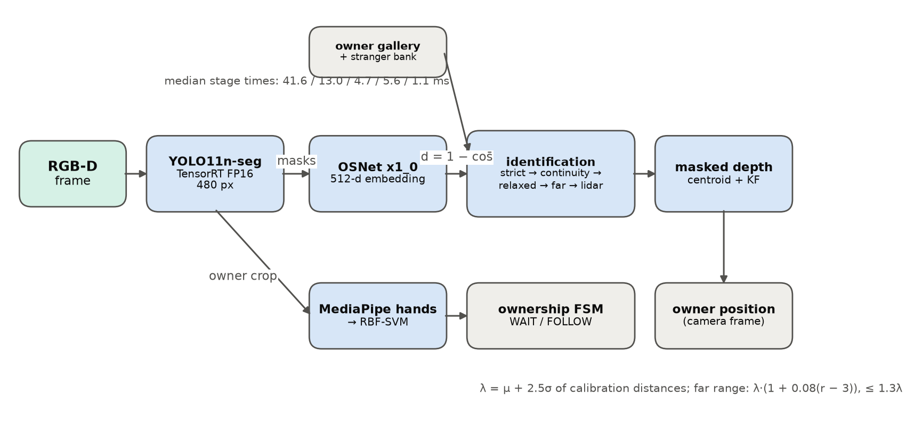
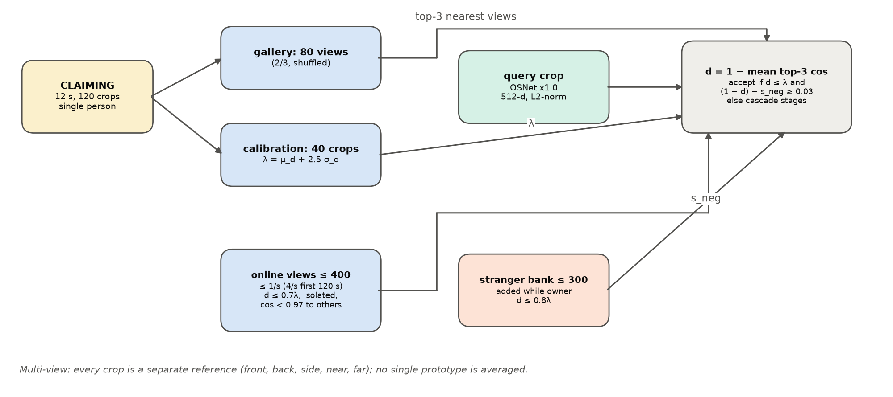
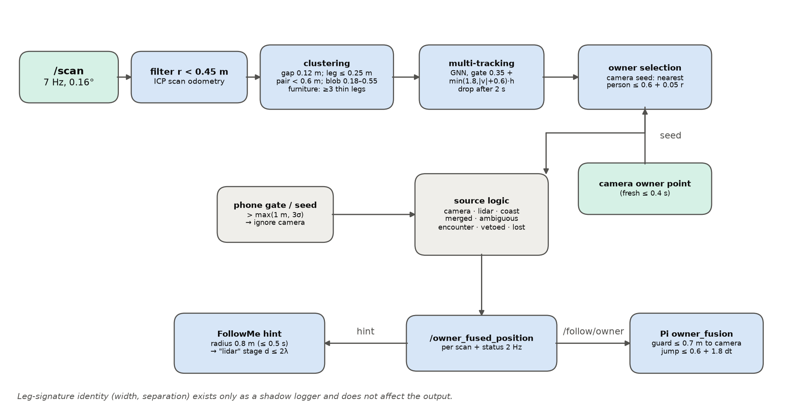
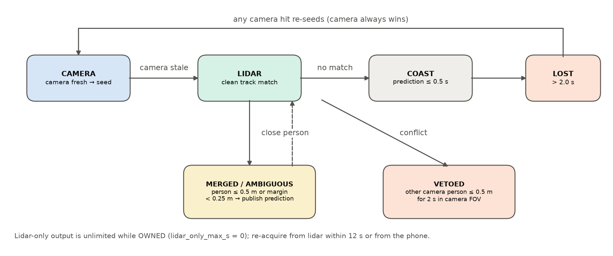
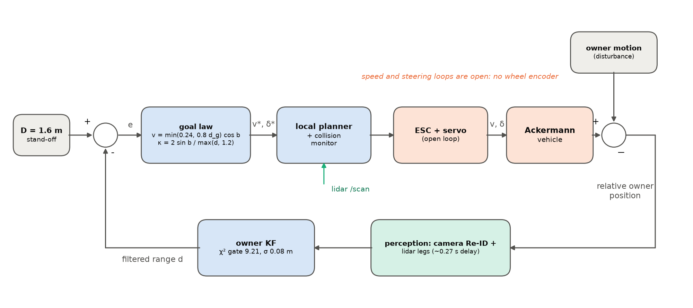

# Project overview

## Platform

| Subsystem | Component | Key specification |
|---|---|---|
| Chassis | RC Ackermann car (WR-01 class) | wheelbase 0.280 m, track 0.25 m, wheel r 0.06 m, δmax 30°, R_min 0.485 m |
| Vision computer | NVIDIA Jetson (Orin Nano class) | 15 W mode, TensorRT FP16 |
| Geometry computer | Raspberry Pi 4 | ROS 2: EKF, owner fusion, planning, collision monitor |
| Camera | Intel RealSense D435 | RGB-D, aligned depth, on a 3D-printed pillar |
| Lidar | Slamtec RPLIDAR A2M12 | 7 Hz, ~2,400 points per turn, 310 mm above ground |
| IMU | GY-91 (MPU-9250, BMP280) | I²C, 50 Hz |
| MCU | Arduino Nano ESP32 | 100 Hz drive loop, JSON link at 921600 baud |
| PWM driver | PCA9685 (0x40) | ch0 steering servo, ch1 ESC |
| ESC / motor | HobbyWing WP880, brushed motor | forward window 1610–1650 µs |
| Battery | 4S LiPo 14.8 V, 6750 mAh | carrier PCB rails 6 V / 5 V / 3.3 V |

## Software data flow

FollowMe (Jetson) publishes the camera owner position; the LiDAR owner keeper (Jetson) publishes the matching lidar track. `owner_fusion` on the Pi selects and vetoes these sources, `follow_manager` filters the owner with a Kalman filter and places a goal at the stand-off distance (1.6 m), `smart_planner` turns the goal into speed and steering, and `cmd_mux` and `collision_monitor` sit between the planner and the serial bridge to the ESP32.

## Adapting FollowMe

| Component | FollowMe (original) | A2R-bot adaptation |
|---|---|---|
| Segmentation | YOLACT++ | YOLO11n-seg, TensorRT FP16, 480 px |
| Re-identification | MMT IBN-ResNet-50, D = 256 | OSNet x1_0, TensorRT, D = 512 |
| Enrolment | calibration sequence | raised palm 1.5 s, 12 s / 120 crops, stranger seeding |
| Owner model | calibrated threshold | multi-view gallery (80 + ≤ 400 views), stranger bank (≤ 300) |
| Decision | d ≤ λ, λ = μ + 2σ | top-3 view distance, λ = μ + 2.5σ, five-stage cascade |
| Tracking | masked depth + KF | + box continuity + LiDAR owner keeper |
| Platform | laboratory robot with GPU | Ackermann car, Jetson + Raspberry Pi 4 + ESP32 |

## Multi-view re-identification

- d(f) = 1 − mean of the three highest cosine similarities between the candidate and the gallery views.
- λ = μ_d + 2.5 σ_d, computed on the 40 held-out enrolment crops.
- Stranger margin: (1 − d) − s_neg ≥ 0.03.
- Online views: at most one per second (four per second for the first 120 s), only if d ≤ 0.7λ, isolated, and not a near-duplicate (cosine < 0.97).
- Acceptance cascade: strict (d ≤ λ) → continuity (IoU ≥ 0.4, d ≤ 1.8λ) → relaxed (d ≤ 1.3λ in the Kalman gate) → far (r > 3 m, scaled threshold, three frames, hint) → lidar (only person within 0.8 m of the keeper hint, d ≤ 2λ). During crossings only strict acceptance is allowed.

## LiDAR-assisted owner keeping

- Scan preprocessing: drop returns closer than 0.45 m; ICP scan odometry.
- Clustering: split at 0.12 m gaps; labels post / leg (≤ 0.25 m) / leg pair (< 0.6 m) / blob (0.18–0.55 m) / furniture.
- Multi-tracking: greedy global nearest neighbour with gate 0.35 + min(1.8, |v| + 0.6)·h m; tracks dropped after 2 s unseen.
- Camera seeding: the nearest person cluster within 0.6 + 0.05·r m of a fresh camera point becomes the owner track (the camera always wins).
- Keeping: lidar-only output while owned; prediction is published when the owner merges with another person; a camera-visible stranger within 0.5 m for 2 s vetoes the track.
- Feedback: the keeper point gives FollowMe a 0.8 m hint (lidar stage of the cascade) and is the preferred owner source for the Pi, guarded by a 0.7 m agreement test with fresh camera points.

## Tracking and control

- Owner Kalman filter: constant velocity, q = 0.6 m/s², σ = 0.08 m, χ² gate 9.21 and innovation ≤ 0.7 m, prediction for up to 2 s.
- Goal law: v = min(0.24, 0.8·(d − D))·cos b, κ = 2 sin b / max(d, 1.2 m), δ = atan(Lκ).
- Speed and steering are **open loop** (no wheel encoder): the bridge maps any non-zero throttle to the 1610–1650 µs ESC window.
- Collision monitor: d_stop = 0.12 + 0.55v + 0.06 m, d_slow = d_stop + 2.5v + 0.15 m (0.31 m / 1.06 m at 0.24 m/s).
- Simulation (`analysis/matlab_sim_and_offline_analysis`): the loop tolerates a perception delay up to π/(2k) ≈ 1.96 s; the measured ≈ 0.27 s leaves a wide margin.
