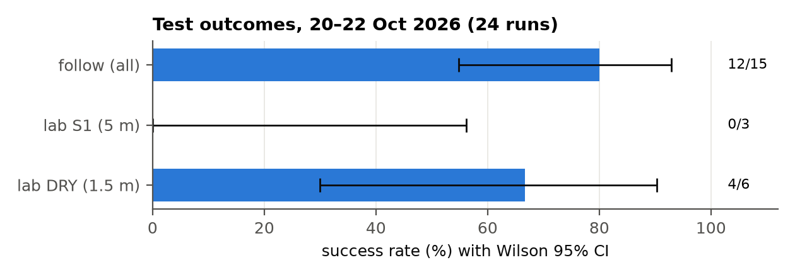
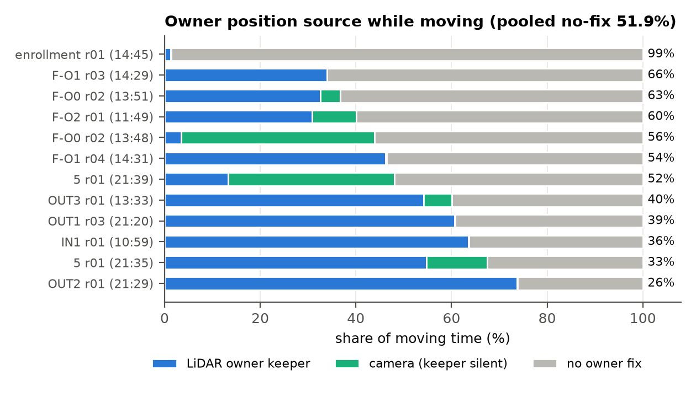
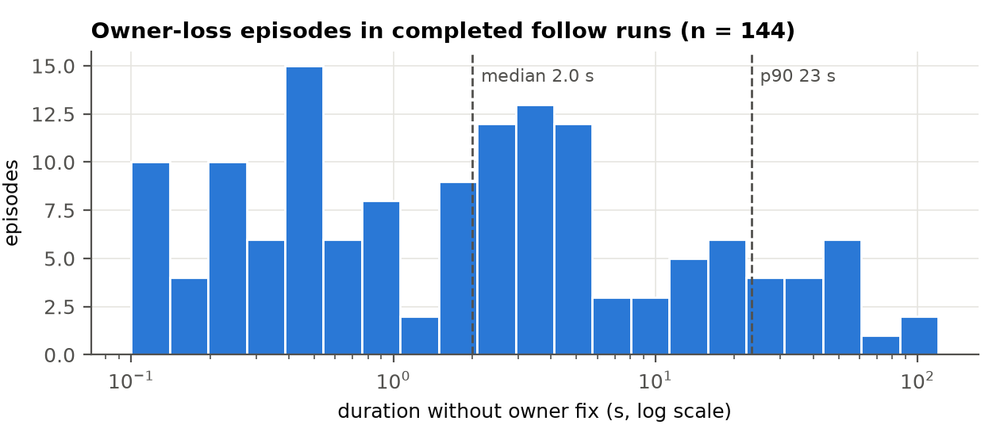
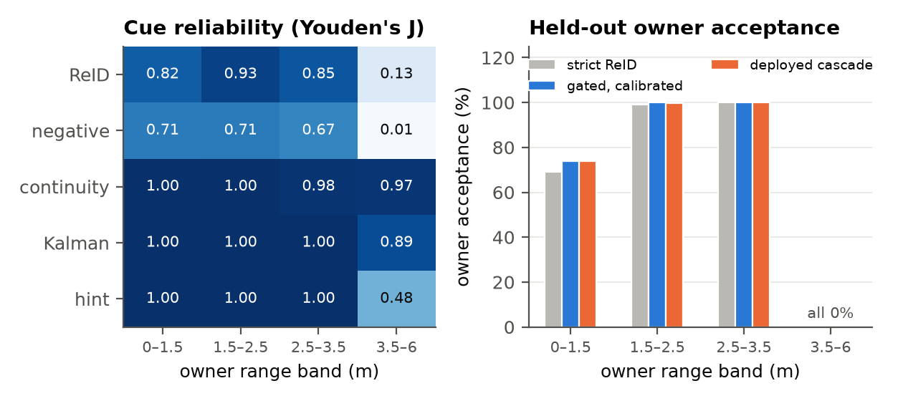
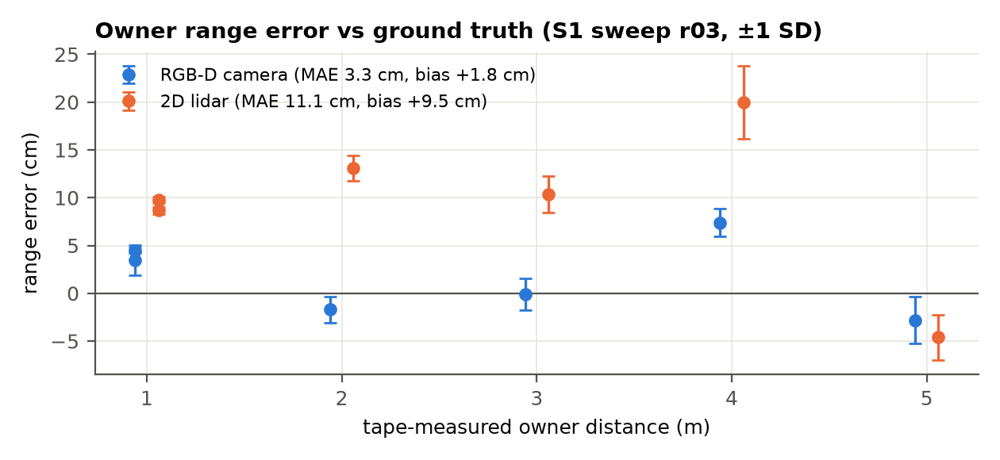
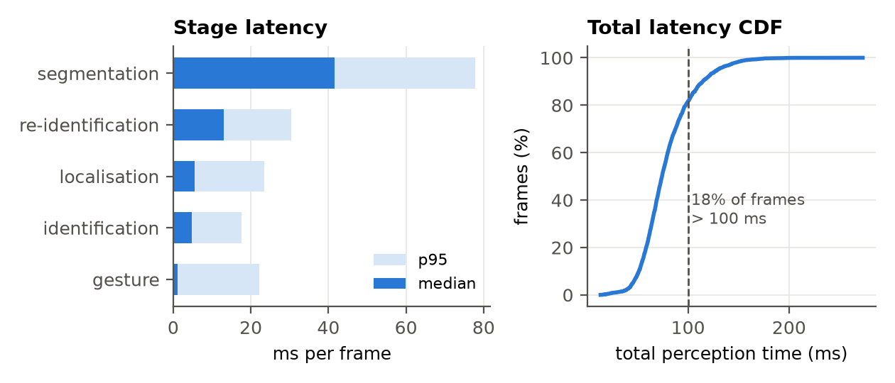

# Results (field tests 20–22 October 2026)

Raw data: [`data/field_tests_2026-10`](../data/field_tests_2026-10) (per-run `summary.json` and `events.csv`, stack logs). All statistics and figure data: [`analysis/A2R-bot_TDK_Thesis_Figure_Data.xlsx`](../analysis/A2R-bot_TDK_Thesis_Figure_Data.xlsx).

## Outcomes

| Test | Runs | Result |
|---|---|---|
| Lab DRY (1.5 m goal) | 6 | 4 SUCCESS, 2 STUCK |
| Lab S1 (5 m goal, DWA) | 3 | 0 reached |
| Follow (indoor, outdoor, obstacle courses) | 15 | 12 DONE (80 %, Wilson 95 % CI 55–93 %), 446 m, no collisions |

The enrollment run is logged as DONE, but the video shows the claim box on a bystander; counted as invalid, follow success is 11 of 15.

## Owner continuity and the LiDAR keeper

- No owner fix for **51.9 %** of moving time in completed runs.
- When the owner was known, the **LiDAR keeper supplied the position 89.9 %** of the time.
- 49 loss events, 44 recovered (90 %); 144 gaps with median 2.0 s, p90 23 s, maximum 98 s.

## Identification

| Rule | Owner acceptance (n = 1,110) | Volunteer frames accepted (n = 295) |
|---|---|---|
| Deployed multi-view cascade | 89.8 % [87.9, 91.5] | 0 |
| Gated fusion, calibrated (offline) | 89.9 % [88.0, 91.5] | 0 |
| Fixed-weight fusion (offline) | 90.2 % [88.3, 91.8] | 1 |
| Strict Re-ID (original FollowMe rule) | 89.0 % [87.0, 90.7] | 1 |

Acceptance is 99–100 % between 1.5 and 3.5 m and zero beyond 3.5 m for every rule.

## Sensors and compute

- Range accuracy (1–5 m): camera MAE 3.3 cm (bias +1.8 cm); lidar MAE 11.1 cm (bias +9.5 cm, likely an unsubtracted mounting offset).
- Perception: median 74 ms, p95 130 ms per frame; segmentation 56 % of the time.
- Jetson at 15 W: CPU 77 % mean, GPU idle in 60 % of samples, 9.3 W.

 

## Known issues and next steps

1. Keeper hint topic: the keeper publishes `/owner_fused_position`, the Pi config names `/owner_keeper/position` (a launch-time remap made the Pi path work); verify that FollowMe receives the 0.8 m hint.
2. Goal-directed search towards the last keeper / Kalman estimate instead of rotating in place.
3. Keep the owner within 1.5–3.5 m; subtract the 10–15 cm lidar offset.
4. Guarded enrolment: claim only the gesturing person.
5. Carrier PCB respin (see [HARDWARE_REVIEW.md](HARDWARE_REVIEW.md)); wheel encoders for a closed speed loop; GPU segmentation.
