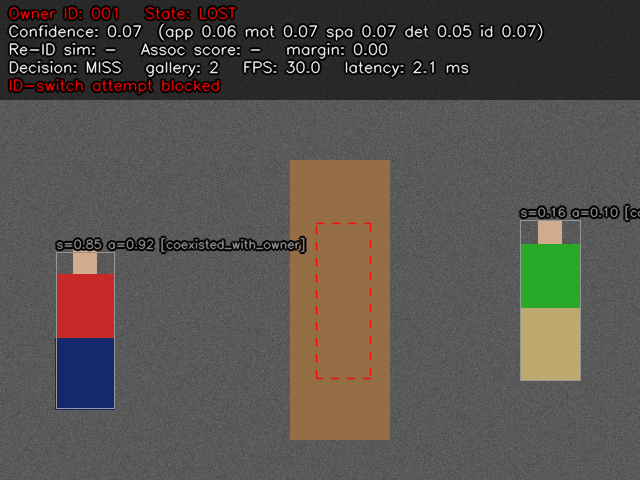

# Identity-preserving single-owner person tracker

The operator clicks one person (the **owner**) in a live OpenCV window; the
tracker follows *that* person and nobody else. Every design decision trades
recall for identity safety: when evidence is unclear the tracker reports
`AMBIGUOUS` or `LOST` and draws no owner box, rather than guessing. An
incorrect owner switch is treated as the worst possible failure.



*Frame from the `occlusion_with_intruders` scenario (debug overlay on). The
owner (red/navy) is behind the pillar; the dashed box is the Kalman
prediction. A look-alike with appearance similarity 0.92 and association
score 0.85 is on screen, but it was seen at the same time as the owner, so it
is excluded (`coexisted_with_owner`) and the switch attempt is blocked.*

---

## 1. Quick start

```bash
pip install -r requirements.txt            # see §9 for Jetson
python -m pytest -q                        # 114 tests, no GPU / models needed
python scripts/run_synthetic_benchmark.py --seeds 10 --jitter 3 --miss-rate 0.05

# Live: webcam 0, default config, CSV log in logs/
python app.py --source 0 --reid-model /path/to/osnet_x0_25_msmt17.pth
python app.py --source clip.mp4 --config config/default.yaml --save-video out.mp4 --log-csv logs/run1.csv
python evaluate.py --gt clip_gt.csv --log logs/run1.csv --owner-id 3
```

Controls: **left-click** a person to select the owner (clicks are ignored
while an owner is locked), **R** reset, **Space** pause, **D** debug scores,
**Q/Esc** quit.

## 2. Project layout

> **FollowMe (arXiv:2311.12992)** is implemented in `followme/`, `followme_app.py` and `ros2/followme_ros` — see [README_FOLLOWME.md](README_FOLLOWME.md).


| Path | Contents |
|---|---|
| `owner_tracking/datatypes.py` | `TrackState`, `Decision`, `Detection`, `CandidateScore`, `ConfidenceReport`, `FrameResult` |
| `owner_tracking/config.py` | Typed dataclass config, YAML loading (unknown keys are errors), validation |
| `owner_tracking/detector.py` | `PersonDetector` interface, `UltralyticsPersonDetector` (YOLOv8/11, `.pt/.onnx/.engine`) |
| `owner_tracking/reid.py` | `PersonReID` interface; `TorchreidReID` (OSNet), `TorchvisionReID`, `HistogramReID` |
| `owner_tracking/factory.py` | Builds detector / Re-ID from config with logged fallbacks |
| `owner_tracking/motion.py` | `MotionPredictor` interface, `KalmanMotionPredictor`, `ShortTermTracklets` |
| `owner_tracking/association.py` | `AssociationScorer` (components, hard gates), threshold + margin rule |
| `owner_tracking/identity.py` | `IdentityManager`: anchor, gated gallery, distractor bank |
| `owner_tracking/confidence.py` | `ConfidenceManager`: five channels → overall → state band |
| `owner_tracking/tracker.py` | `OwnerTracker`: click selection, owner lock, per-frame pipeline, state machine |
| `owner_tracking/visualization.py` | Overlay (owner box, dashed prediction, info panel, debug scores) |
| `owner_tracking/logging_utils.py` | `CsvFrameLogger` |
| `owner_tracking/stats.py` | FPS and per-stage latency (mean / p50 / p95) |
| `owner_tracking/evaluation.py` | Owner-centric metrics + GT / log loaders |
| `owner_tracking/simulation.py` | Deterministic synthetic scenes for crossing / occlusion / look-alike tests |
| `owner_tracking/baselines.py` | Proximity-only baseline for comparison |
| `app.py`, `evaluate.py`, `scripts/run_synthetic_benchmark.py` | CLIs |
| `config/default.yaml` | All parameters (mirrors the dataclass defaults exactly; tested) |
| `tests/` | Association unit tests, scenario tests, metric tests |

Every component sits behind an interface (`PersonDetector`, `PersonReID`,
`MotionPredictor`), so YOLO, the Re-ID network or the motion model can be
swapped without touching the tracker. Adding a backend = one class + one
entry in `factory.py`.

## 3. Per-frame pipeline

```
frame ─► detector ─► short-term tracklets (velocity per detection)
      └► Kalman predict ─► Mahalanobis d² per detection
      └► Re-ID embeddings (raw frame, never the overlay buffer)
           │
           ▼
   component scores (all in [0,1]) ─► weighted association score
           │
           ▼
   hard gates (co-existence, reachability, appearance floor, distractor,
               Kalman gate, velocity gate, motion plausibility)
           │
           ▼
   identity threshold + score margin ─► MISS / AMBIGUOUS / candidate
           │
           ▼
   temporal confirmation (fast path only for an unbroken track)
           │
     ACCEPT ─► Kalman update, velocity, gated gallery / distractor update
           │
           ▼
   five confidence channels ─► smoothed overall ─► state machine ─► output
```

The owner box is output (and logged in `owner_bbox`) **only** in `TRACKING`
or `LOW_CONFIDENCE` after an `ACCEPT`. In every other state the UI shows only
the dashed prediction.

## 4. Algorithmic components

### 4.1 Detection
`UltralyticsPersonDetector` runs YOLO restricted to class 0 (person), with
configurable confidence / NMS thresholds, input size, FP16 on CUDA and a
minimum box height (tiny boxes give unreliable embeddings). Any Ultralytics
model format works, including TensorRT `.engine`. Detections carry a
`source_id` field used **only** by the simulator and evaluator; the tracker
never reads it.

### 4.2 Appearance (Re-ID)
Crops are taken as NumPy views (no copies) and batched. `TorchreidReID` uses
OSNet via `torchreid.utils.FeatureExtractor` (BGR→RGB, 256×128). Embeddings
are L2-normalised so cosine similarity is a dot product; invalid crops give a
zero vector, which the `invalid_embedding` gate rejects. **Use ReID-trained
weights** (`reid.model_path`, e.g. OSNet trained on MSMT17): ImageNet weights
are logged as a warning because they separate people poorly.
`TorchvisionReID` (MobileNetV3, ImageNet) is a weak fallback;
`HistogramReID` (HSV colour histograms over horizontal stripes) is a
deterministic, dependency-free backend used by the tests. The factory tries
`backend` then `fallback_backends`, logging each failure.

### 4.3 Owner identity model (`IdentityManager`)
* **Anchor** — the embedding at the click. It is never replaced and always
  contributes `anchor_weight` (0.4) of the similarity, so the model cannot
  drift entirely to someone else.
* **Gallery** (≤ 30 embeddings) — similarity = `0.4·anchor + 0.6·mean(top-5
  gallery)`, which handles pose / lighting change. An embedding is admitted
  only if **all** of these hold: state is `TRACKING`; overall confidence ≥ 0.8;
  similarity ≥ 0.55; margin over the runner-up ≥ 0.2; no other detection
  overlaps the owner (IoU ≤ 0.1, so the crop is not contaminated); ≥ 10 stable
  frames since the last (re)acquisition; ≥ 5 frames since the last update; and
  not a near-duplicate (cos ≥ 0.97) of an existing entry.
* **Distractor bank** (≤ 64) — embeddings of clearly separate other people
  (IoU ≤ 0.05). A candidate that looks more like a known distractor than like
  the owner (by `distractor_margin`) is rejected. Look-alikes (owner
  similarity ≥ 0.80) are deliberately **not** stored: they carry no
  discriminative information and, during debugging, caused the real owner to be
  rejected. Look-alikes are handled by motion evidence and the margin rule.

### 4.4 Motion (`KalmanMotionPredictor`)
8-state constant-velocity Kalman filter over `(cx, cy, w, h)` and their
velocities (OpenCV `KalmanFilter`, float64). Process and measurement noise
scale with box height, so behaviour is independent of distance to the camera.
The squared Mahalanobis distance of each detection (computed with a Cholesky
solve of the innovation covariance) is converted to a p-value with the closed
form χ²(4) survival function `exp(-d²/2)(1 + d²/2)`, and hard-gated at the 95 %
quantile (9.4877). While unseen, the gate grows linearly (`gate_growth_per_frame`)
up to `max_gate_multiplier`, velocity is damped in search mode, and prediction
stops after `max_prediction_frames`; after a long gap the filter is
re-initialised at re-acquisition instead of being updated with a huge
innovation.

### 4.5 Short-term tracklets (`ShortTermTracklets`)
A deliberately conservative detection-to-detection linker that supplies a
velocity for each current detection and a tracklet id. Links require mutual
best IoU ≥ 0.5 with a clear gap to the second choice; tracklets that overlapped
another person within the last 3 frames are not linked (that is exactly where
a naive linker swaps identities); stale tracklets survive ≤ 5 missed frames
and only if they were not merged into another box. Overlap is
*motion-compensated*: each previous box is also advanced by its tracklet's
velocity (once that velocity is based on ≥ 3 links) and the better of the plain
and shifted IoU is used, so a walking person still links at low frame rates. When unsure, the linker
starts a new tracklet — which the tracker treats as a *broken* track that must
be re-confirmed. Tracklet ids enable two anti-switch rules (§5).

### 4.6 Association score
All components are normalised to `[0, 1]`:

| Component | Definition |
|---|---|
| appearance | owner similarity mapped linearly from [floor 0.20, ceiling 0.85] to [0,1] |
| IoU | IoU with the Kalman-predicted box |
| position | `exp(-½ (d / (0.5·h_pred))²)`, centre distance in predicted-height units |
| scale | `exp(-(log²(h/h_ref) + log²(w/w_ref)) / (2·0.25²))` |
| motion | geometric mean of the Mahalanobis p-value and `exp(-½ z_v²)`, where `z_v` is the velocity disagreement with the owner in noise units |
| detection | detector confidence |

`score = Σ wᵢ·cᵢ / Σ wᵢ` over *available* components (a missing prediction
removes IoU/position/motion rather than scoring them 0). Default tracking
weights are the specified .40/.20/.15/.10/.10/.05. While `LOST` a separate
set (`reid_weights` .70/0/.05/.10/.10/.05) is used because IoU with a stale
prediction is meaningless. Detection confidence has only 5 % weight — a
0.99-confidence stranger cannot out-score a 0.55-confidence owner (tested).

### 4.7 Hard gates
Applied before the threshold rule; a gated candidate can never become the
owner that frame, whatever its score. In order: `coexisted_with_owner`
(tracklet seen alongside the confirmed owner, §5), `unreachable` (farther than
a person can move since last seen: `(0.5 + 0.06·frames)·height`),
`invalid_embedding`, `appearance_floor` (0.35 tracking, 0.60 while lost),
`resembles_distractor`, `motion_gate` (Kalman χ² gate), `velocity_gate`
(z > 3 while owner velocity is reliable), `implausible_motion` (motion score
< 0.05 during re-ID when a prediction exists). Rejections are shown in the
debug overlay and counted.

### 4.8 Confidence (`ConfidenceManager`)
Five separate channels: appearance, motion, spatial (IoU/position), detection
and identity (`½·score + ½·min(1, margin / 0.3)`), fused with weights
.35/.15/.15/.05/.30 and smoothed with an EMA (0.6 on the new value). Frames
without an accepted measurement decay the confidence (×0.85 on a miss, ×0.95
when ambiguous). Configurable bands: ≥ 0.75 `TRACKING`, ≥ 0.50
`LOW_CONFIDENCE`, ≥ 0.30 `AMBIGUOUS`, below → `LOST`.

## 5. Anti-ID-switch layers

1. **Identity threshold** — best score < `IDENTITY_THRESHOLD` (0.55; 0.60 in
   re-ID) → `MISS`.
2. **Minimum score margin** — best − second < `MIN_SCORE_MARGIN` (0.12; 0.15
   in re-ID) → `AMBIGUOUS`, select neither. The runner-up counts even if it is
   itself below threshold.
3. **Temporal confirmation** — a new hypothesis must remain the best,
   spatially consistent (IoU ≥ 0.3 with the previous pending box) for 4
   frames (5 in re-ID) before it is accepted. The fast path (accept in one
   frame) is allowed only for an unbroken track: continuous with the last
   owner box, the *same* tracklet link, not in search mode. While the owner's
   velocity is reliable, confirmation also requires the candidate to have a
   measured velocity (so a freshly spawned box at a crossing cannot confirm).
   Accumulated evidence stays bound to one detection-level tracklet: it may
   carry over to a *new* tracklet at the same place (a refused link), but not
   if any other person was within one box height in the last
   `confirmation_frames` frames — otherwise a person crossing the pending box
   could inherit the evidence.
4. **Owner lock** — `owner_id` is assigned once at the click; `select_owner`
   refuses while locked; only an explicit **R** resets. Nothing in the
   automatic pipeline can re-assign it.
5. **Co-existence exclusion** — any tracklet observed *simultaneously* with
   the confirmed owner is provably someone else and is excluded for its
   lifetime. This is what stops a look-alike being adopted while the owner is
   hidden (see image above).
6. **Velocity-strike exclusion** — a tracklet that repeatedly (8 frames)
   violates the owner's velocity is excluded.
7. **Physical reachability** — candidates farther than a person could have
   walked since last seen are rejected, which prevents exploding Kalman
   covariance from letting a far-away person in.
8. **No auto-adoption** — `LOST` never ends by picking "whoever is there";
   re-ID requires the stricter thresholds, margin, gates and confirmation.

Every frame in which a naive tracker would have jumped (ambiguous frames, a
gated candidate scoring above threshold, a non-continuous pending hypothesis)
is flagged `identity_switch_attempt=1` in the CSV and counted as
`identity_switch_attempts_blocked`.

## 6. Occlusion, LOST and long-term re-identification

On a miss the tracker coasts on the Kalman prediction and widens the gate.
After 10 consecutive misses (or 30 unresolved/ambiguous frames, or confidence
falling below the `LOST` band) it enters **search mode** (`LOST`): the
re-ID weight set, `REID_THRESHOLD` (raw cosine ≥ 0.60), the stricter score
threshold and margin, reachability and co-existence exclusions apply, and a
candidate passing all of them moves the state to `REIDENTIFYING` while it
collects 5 confirming frames. Only then does the state return to `TRACKING`
(counted as a re-identification), the Kalman filter is re-initialised, and
gallery updates resume after the stability period. Where a prediction still
exists, trajectory consistency is enforced via `reid_min_motion_score`; after
`max_prediction_frames` only appearance, scale, reachability and exclusions
remain.

## 7. State machine

| State | Meaning | Owner box shown |
|---|---|---|
| `TRACKING` | accepted this frame, confidence ≥ 0.75 | yes (green) |
| `LOW_CONFIDENCE` | accepted, 0.50–0.75 | yes (orange) |
| `AMBIGUOUS` | competitors too close, or confidence 0.30–0.50 | no (magenta prediction) |
| `REIDENTIFYING` | a candidate is collecting confirmation after loss | no |
| `LOST` | search mode | no (red prediction) |

The more severe of the decision-driven and confidence-driven states wins.

## 8. Logging, performance and evaluation

`CsvFrameLogger` writes the required columns (`timestamp, frame_number,
owner_bbox, detection_confidence, appearance_similarity, IoU, motion_score,
association_score, tracking_state, identity_switch_attempt`) plus diagnostics
(decision, margin, all confidence channels, gallery size, latency…) and
`top_candidate_rejected` / `rejections` (which hard gates refused which
candidates), the first place to look when diagnosing LOST events. Frames
with a switch attempt are always logged even with `interval > 1`.
`PerformanceStats` gives rolling FPS and mean/p50/p95 latency per stage.

`evaluate.py` computes, for the owner only: **incorrect owner switches**
(headline metric: number of times a non-owner person is reported), false
owner frames, ID switches, precision, recall, MOTA, IDF1, HOTA, loss-episode
count/mean/max duration, re-ID success rate and re-acquisition latency, FPS
and latency. Definitions are in the `evaluation.py` docstring. Two notes:
IDF1's IDTP equals TP because the tracker's only identity is bound to the owner
by the click; and with one GT and one predicted identity HOTA's association
accuracy equals its detection accuracy, so HOTA reduces to DetA averaged over
the 19 IoU thresholds. For multi-person benchmarks (MOT17/20, DanceTrack) use
TrackEval on the owner's GT track.

## 9. Calibrating weights and thresholds

The defaults were set by reasoning and tuned on the synthetic suite; they
**must be recalibrated** for a real camera, Re-ID model and frame rate:

1. Record footage with crossings, occlusions and look-alikes; annotate all
   people (`frame,person_id,x1,y1,x2,y2`).
2. Run with `logging.interval: 1` and `D` debug; for every frame and every
   candidate log the component scores with a label *owner / not owner*.
3. **Weights:** fit a logistic regression (or grid-search on the simplex)
   on the components, objective = minimise incorrect switches subject to a
   recall floor; the fitted coefficients, normalised, are the weights.
4. **`IDENTITY_THRESHOLD` / `REID_THRESHOLD`:** from the ROC of owner vs
   non-owner scores, choose the operating point with near-zero false accept
   rate (e.g. FPR ≤ 0.1 %), not the equal-error point.
5. **`MIN_SCORE_MARGIN`:** from the distribution of (owner − best non-owner)
   score in frames where both are present, take a low percentile of the
   correct-case margin that still exceeds almost all wrong-case margins.
6. **Confirmation frames and speed parameters** are per-frame quantities:
   scale `confirmation_frames`, `max_speed_heights_per_frame`, `velocity_*`
   and frame-count timeouts with the camera frame rate (defaults assume
   ~30 fps).
7. Re-check on held-out sequences with `evaluate.py`; iterate.

## 10. Hardware: GPU, CPU fallback, Jetson

`runtime.device: auto` picks CUDA if available, else CPU (torch is optional for
the core logic). FP16 is used only on CUDA. For Jetson (JetPack 5/6): install
NVIDIA's torch/torchvision wheels, then

```bash
yolo export model=yolo11n.pt format=engine half=True imgsz=640 device=0
python app.py --detector-model yolo11n.engine --reid-backend torchreid --reid-model osnet_x0_25_msmt17.pth
```

For more speed export OSNet to ONNX → TensorRT and add a small `PersonReID`
subclass; set `reid.prefilter_by_motion_gate: true` to skip embedding people
far outside the gate; use `yolo11n` / `osnet_x0_25` and a 480–640 input.

## 10b. Low frame rates (Jetson running PyTorch models)

The defaults assume ~30 fps. At ~8–12 fps a walking person moves three times
farther per frame, so the motion gates and reachability limit become too tight
and the owner is repeatedly dropped and re-identified. Use

```bash
python app.py --source realsense --config config/jetson_low_fps.yaml --reid-model ...
```

which scales every per-frame motion and timing parameter by ~3 and lowers the
detector threshold to 0.20 (detector confidence has 5 % weight, so this does
not let strangers win). Identity thresholds, margins and confirmation counts
are unchanged. Better still, raise the frame rate (TensorRT engine, §10) and
use `default.yaml`.

## 10a. Intel RealSense (D435 and similar)

```bash
pip install pyrealsense2
python app.py --source realsense --reid-model path/to/osnet.pth
python app.py --source realsense --rs-width 1280 --rs-height 720 --rs-fps 30
python app.py --source realsense:123456789012      # pick a camera by serial
```

`owner_tracking/camera.py` (`RealSenseCapture`) reads the BGR colour stream
through librealsense, discards ~30 warm-up frames so auto-exposure settles
before you click (the owner's anchor embedding is taken from that frame), and
gives clear errors for a missing device, an unsupported mode or a camera that
is already open elsewhere. Use a USB 3 port. The camera also works as a plain
webcam (`--source N`), but on Linux it exposes several `/dev/video*` nodes and
the colour one is not always index 0. On Jetson, pip wheels for pyrealsense2
are usually unavailable; build librealsense with `-DBUILD_PYTHON_BINDINGS=ON`.
Aligned depth can be enabled (`RealSenseCapture(enable_depth=True)`,
`last_depth_m`) but is **not yet used** by the association.

## 11. Results on the synthetic suite

10 seeds, `HistogramReID`, detector jitter 3 px and 5 % missed detections.
Owner tracker vs a proximity-only baseline (totals over seeds for the first
two columns, means otherwise):

| Scenario | Method | Incorrect switches | False-owner frames | Recall | Precision | IDF1 | Re-ID success |
|---|---|---|---|---|---|---|---|
| crossing_distinct | owner tracker | **0** | **0** | 0.81 | 1.00 | 0.89 | 1.00 |
| | nearest-neighbour | 25 | 333 | 0.61 | 0.61 | 0.61 | 0.00 |
| crossing_similar | owner tracker | **0** | **0** | 0.82 | 1.00 | 0.90 | 1.00 |
| | nearest-neighbour | 25 | 333 | 0.61 | 0.61 | 0.61 | 0.00 |
| crossing_similar_owner_front | owner tracker | **0** | **0** | 0.79 | 1.00 | 0.88 | 1.00 |
| | nearest-neighbour | 21 | 197 | 0.74 | 0.77 | 0.75 | 0.00 |
| side_by_side_similar | owner tracker | **0** | **0** | 0.43 | 1.00 | 0.60 | 0.10 |
| | nearest-neighbour | 30 | 380 | 0.67 | 0.68 | 0.68 | 0.00 |
| occlusion_with_intruders | owner tracker | **0** | **0** | 0.75 | 1.00 | 0.86 | 0.50 |
| | nearest-neighbour | 23 | 298 | 0.79 | 0.75 | 0.77 | 0.10 |
| high_confidence_intruder | owner tracker | **0** | **0** | 0.77 | 1.00 | 0.87 | 1.00 |
| | nearest-neighbour | 24 | 259 | 0.71 | 0.70 | 0.71 | 0.00 |
| long_term_reid | owner tracker | **0** | **0** | 0.90 | 1.00 | 0.95 | 1.00 |
| | nearest-neighbour | 0 | 0 | 0.34 | 1.00 | 0.51 | 0.80 |

Zero wrong-owner frames were also observed over 20 seeds at jitter 1.5 px /
no misses, at 4 px / 10 % misses, and with the low-fps profile when only
every 3rd or 4th frame is processed (~10 / ~7.5 fps; part of the test suite).
The price is recall: the tracker spends frames in `AMBIGUOUS`/`REIDENTIFYING`
around every crossing, and in `side_by_side_similar` it often stays lost after
two identical people overlap (recall ≈ 0.43) — the intended behaviour when
nothing distinguishes them. The low re-ID rate in `occlusion_with_intruders`
comes mostly from a second occlusion behind a stranger near the end of the
clip, which the metric counts as a failure when the sequence ends first.

## 12. Limitations (read before deploying)

* **Synthetic tests validate the decision logic, not real-world accuracy.**
  Rendered rectangles with colour-histogram Re-ID are far simpler than real
  people; real performance depends on the detector, the Re-ID weights and
  calibration (§9). Validate on annotated footage from your camera.
* Identically dressed people who separate while the owner is unseen cannot be
  told apart by any appearance model; the tracker will (correctly) stay
  `LOST`/`AMBIGUOUS` and may need the operator to re-click after **R**.
* Long absences rely on appearance alone once the prediction expires; clothing
  change or strong lighting change can prevent re-identification (by design it
  fails safe, not by switching).
* Speed/timeout parameters are in frames; frame drops on slow hardware change
  their meaning. Process at a stable rate or scale the parameters.
* No camera-motion compensation: a moving or panning camera will violate the
  constant-velocity model and reachability gate (add ECC/optical-flow
  compensation before the Kalman predict for mobile platforms).
* Deep backends (Ultralytics, Torchreid) are implemented against their public
  APIs but were not executed in the development environment, which had no
  torch; the core pipeline was tested with the histogram backend.
